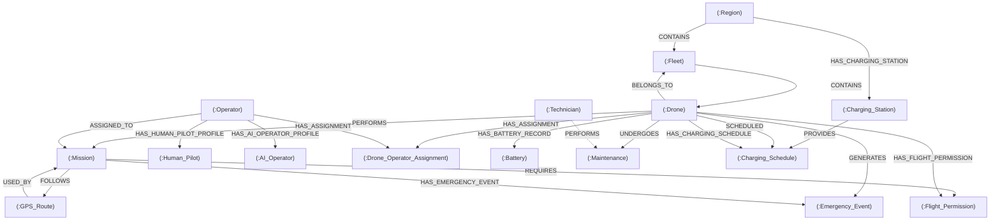

# ER to Graph Relationship Mapping

This document details the transformation of the relational Entity-Relationship (ER) model and Foreign Key constraints into a high-performance, native Neo4j property graph.

---

## 1. Conceptual Architecture & Transformation Philosophy

In relational database systems, associations between entities are stored as disconnected scalar foreign key values that require costly JOIN operations at query runtime.
In Neo4j:
1. **Foreign keys are materialized as direct first-class graph relationships** (`(NodeA)-[:REL_TYPE]->(NodeB)`), enabling index-free adjacency traversals in $O(1)$ time.
2. **Associative entities with independent attributes** (such as `Drone_Operator_Assignment` which contains an assignment date, status, and mission type) are retained as explicit nodes.
3. **Specialization hierarchies** (`Operator` $\rightarrow$ `Human_Pilot`, `AI_Operator`) are preserved using typed profile relationships.

---

## 2. Core ER Diagram Relationships

These relationships directly correspond to the original ER Diagram specifications:

| Source Entity | Relationship Name | Target Entity | ER Cardinality | Graph Direction | Semantic Description |
| :--- | :--- | :--- | :--- | :--- | :--- |
| `Fleet` | `CONTAINS` | `Drone` | 1:N | `(Fleet)-[:CONTAINS]->(Drone)` | Fleet consists of multiple physical drones |
| `Drone` | `PERFORMS` | `Mission` | 1:N | `(Drone)-[:PERFORMS]->(Mission)` | Drone flies and executes a flight mission |
| `Operator` | `ASSIGNED_TO` | `Mission` | 1:N | `(Operator)-[:ASSIGNED_TO]->(Mission)` | Human pilot or AI oversees the mission |
| `Mission` | `FOLLOWS` | `GPS_Route` | N:1 | `(Mission)-[:FOLLOWS]->(GPS_Route)` | Mission navigates along a GPS route corridor |
| `Drone` | `UNDERGOES` | `Maintenance` | 1:N | `(Drone)-[:UNDERGOES]->(Maintenance)` | Drone receives maintenance/calibration |
| `Technician` | `PERFORMS` | `Maintenance` | 1:N | `(Technician)-[:PERFORMS]->(Maintenance)` | Technician executes maintenance service |
| `Drone` | `SCHEDULED` | `Charging_Schedule` | 1:N | `(Drone)-[:SCHEDULED]->(Charging_Schedule)` | Drone is booked for depot recharging |
| `Charging_Station` | `PROVIDES` | `Charging_Schedule` | 1:N | `(Charging_Station)-[:PROVIDES]->(Charging_Schedule)` | Charging station reserves a power slot |
| `Drone` | `GENERATES` | `Emergency_Event` | 1:N | `(Drone)-[:GENERATES]->(Emergency_Event)` | Drone triggers an in-flight alert/incident |
| `Mission` | `REQUIRES` | `Flight_Permission` | 1:1 (Diagram) / N:1 (DB) | `(Mission)-[:REQUIRES]->(Flight_Permission)` | Flight clearance issued by DGCA |

---

## 3. Foreign Key Graph Enhancements

To faithfully capture every relational foreign key in the handwritten Oracle DDL while maintaining bidirectional navigability, the following graph edges were established:

| Source Entity | Relationship Name | Target Entity | Original Foreign Key Reference | Description |
| :--- | :--- | :--- | :--- | :--- |
| `Region` | `CONTAINS` | `Fleet` | `Fleet.Region_ID -> Region.Region_ID` | Fleets stationed in a geographic region |
| `Drone` | `BELONGS_TO` | `Fleet` | `Drone.Fleet_ID -> Fleet.Fleet_ID` | Reverse traversal from Drone to Fleet |
| `Operator` | `HAS_HUMAN_PILOT_PROFILE`| `Human_Pilot` | `Human_Pilot.Operator_ID -> Operator.Operator_ID`| Connects human pilot license profile |
| `Operator` | `HAS_AI_OPERATOR_PROFILE` | `AI_Operator` | `AI_Operator.Operator_ID -> Operator.Operator_ID` | Connects autonomous software profile |
| `Drone` | `HAS_ASSIGNMENT` | `Drone_Operator_Assignment`| `Assignment.Drone_ID -> Drone.Drone_ID` | Links operational pairing node to drone |
| `Operator` | `HAS_ASSIGNMENT` | `Drone_Operator_Assignment`| `Assignment.Operator_ID -> Operator.Operator_ID`| Links operational pairing node to operator|
| `GPS_Route` | `USED_BY` | `Mission` | `Mission.Route_ID -> GPS_Route.Route_ID` | Reverse traversal from Route to Missions |
| `Drone` | `HAS_BATTERY_RECORD` | `Battery` | `Battery.Drone_ID -> Drone.Drone_ID` | Connects battery health telemetry |
| `Region` | `HAS_CHARGING_STATION` | `Charging_Station` | `Charging_Station.Region_ID -> Region.Region_ID`| Links ground station to its region |
| `Drone` | `HAS_CHARGING_SCHEDULE`| `Charging_Schedule` | `Charging_Schedule.Drone_ID -> Drone.Drone_ID` | Explicit schedule traversal |
| `Mission` | `HAS_EMERGENCY_EVENT` | `Emergency_Event` | `Emergency_Event.Mission_ID -> Mission.Mission_ID`| Connects incident report to active sortie |
| `Drone` | `HAS_FLIGHT_PERMISSION`| `Flight_Permission` | `Flight_Permission.Drone_ID -> Drone.Drone_ID` | Connects aviation permit to drone |

---

## 4. Mermaid Graph Schema Visualization

